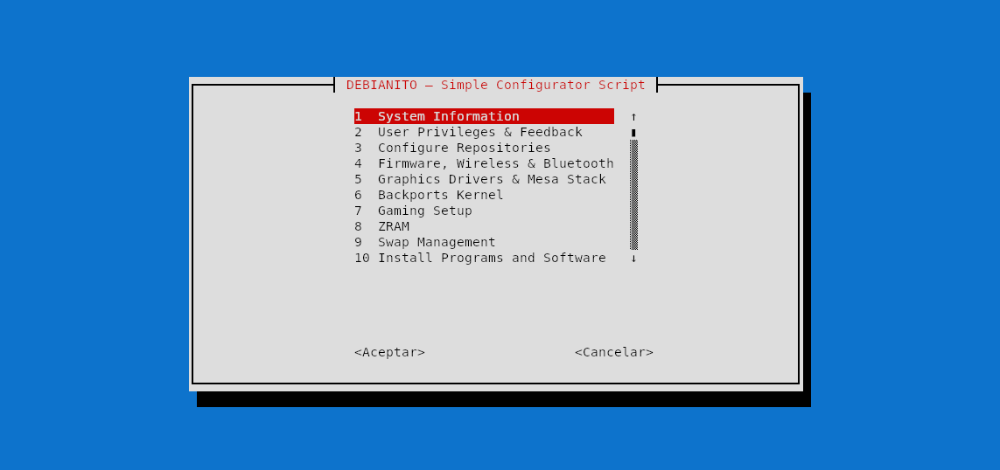

<h1 align="center">Debianito - Post-Installation Automation for Debian</h1>

<div align="center">

Debianito is a post-installation automation script for Debian 11 (Bullseye), Debian 12 (Bookworm) and Debian 13 (Trixie). An interactive menu guides system configuration, driver installation (including NVIDIA drivers), repository setup with backports support and gaming tools.

[](https://github.com/stornic56/debianito-post-install/blob/main/LICENSE)


</div>

---

## System Requirements

| Requirement | Specification |
|-------------|---------------|
| **OS**      | Debian 11 (Bullseye), Debian 12 (Bookworm), Debian 13 (Trixie) |
| **Privileges** | Normal user with `sudo` access, script validates root/sudo in utils.sh |
| **Terminal**   | Any modern terminal emulator supporting ANSI colors and UTF-8 box-drawing characters |
| **Dependencies**     | Standard Debian packages (`whiptail`, `lsb-release`); auto-installed if missing |

---

## Installation Instructions

Clone the repository, make the script executable, and run it:

```bash
git clone https://github.com/stornic56/debianito-post-install
cd debianito-post-install
chmod +x debianito.sh && ./debianito.sh
```

> ⚠️ **Do not run as root.** The script checks for non-root execution and requires sudo privileges.

---

## Command-Line Usage

Running `./debianito.sh` with no arguments starts the interactive menu. Three flags change that behavior:

| Flag | Effect |
| ---- | ------ |
| `--yes` | Auto-confirms prompts (unattended mode). Menus still display and still require interaction. |
| `--allow-destructive` | Allows destructive operations, such as branch migration, without the extra safety gate. |
| `--help`, `-h` | Show usage and exit. |

`--yes` alone still blocks branch migration, which is the one operation that can leave the system unbootable. When that happens the script stops and prints `Branch migration is destructive. Re-run with --allow-destructive, or drop --yes to confirm interactively.` to stderr. Combine both flags to run everything unattended:

```bash
./debianito.sh --yes --allow-destructive
```

An unknown option exits with status 2. For boot profiling, set `DEBIANITO_PROFILE=1` to stamp each boot step to stderr with a timestamp:

```bash
DEBIANITO_PROFILE=1 ./debianito.sh
```

---

## Usage

After running the script:

1. **Select Option:** Use arrow keys or type 1-14.
2. **Navigation:** Use Arrow Keys (Up↑/Down↓) to move between list options and ENTER key to confirm selection.
3. **Confirm Actions:** Installation prompts use whiptail for TUI confirmations. Before a batch of packages is applied, the script shows what it is about to install (up to 15 package names plus a count of the rest) and asks you to proceed.
4. **Review System Info:** Header displays detected Debian version and hardware summary before each action.
5. **Repeat as Needed:** Return to main menu at any time or exit when done.

| Option | Description | What it does |
| -------- | ------------- | -------------- |
| **1** | [System Info](/docs/system_info.md) | Show detected OS, CPU, RAM, GPU and hardware details |
| **2** | [User Privileges & Feedback](/docs/user_priv_feed.md) | Configure sudo group membership, enable passwordless sudo for frequent tasks, repair home directory ownership issues, and toggle visual password feedback (asterisks) in terminal |
| **3** | [System Preferences](/docs/system_prefs.md) | Configure date/time & timezone, language/locales & keyboard layout, and audio stack (PipeWire, ALSA, PulseAudio) |
| **4** | [Configure Repositories](/docs/repos_config.md) | Setup official repos with non-free/contrib options, optional Backports support and Deb822/classic format injection |
| **5** | [Firmware, Wireless & Bluetooth](/docs/firmware.md) | Install essential firmware for GPUs and wireless; configure Bluetooth stack (bluez, bluedevil/blueman) |
| **6** | [Graphics Drivers & Mesa Stack](/docs/gpu.md) | Configure AMD/Intel/NVIDIA drivers and Mesa graphics stack + monitoring tools |
| **7** | [Kernel](/docs/kernel.md) | Install kernel variants: Stable, RT, Cloud, or Backports (Debian 13) |
| **8** | [Gaming Setup](/docs/gaming.md) | Steam, Heroic Games Launcher, [RetroArch](/docs/retroarch.md), GameMode, MangoHud, OpenRGB, Java JRE (Temurin 8/17/21/25) |
| **9** | [ZRAM](/docs/zram.md) | Configure compressed RAM for memory optimization |
| **10** | [Swap Management](/docs/swap.md) | Manage swap file or partition size and enable/disable swap space for system stability |
| **11** | Install Programs and Software | Browse and install packages by category (Development, Themes, System Tools, etc.) using APT |
| **12** | [Boot Rescue + GRUB](/docs/boot.md) | Config and fix GRUB bootloader issues, chroot repair, or restore system boot configuration |
| **13** | [Desktop & Display](/docs/desktops_display.md) | Install and configure desktops (XFCE, LXDE, GNOME, KDE Plasma) and display managers (LightDM, GDM3, SDDM, greetd) |
| **14** | Exit | Return to terminal |

### Install Programs and Software (Option 11)

The submenu offers these categories:

| Option | Category Title | Description |
| -------- | ------------------------------- | ------------- |
| **0** | Essential Pack | Quick install of common tools (compression, system info, VLC, MS fonts) |
| **1** | Customization System | Desktop themes, icon themes, cursor themes, and fonts |
| **2** | Download & Network | Downloaders (aria2, ytdlp, FileZilla) + Torrent clients (qBittorrent, Deluge, Transmission) |
| **3** | Internet (Browsers, Email Clients, VPN) | Web browsers (Firefox, LibreWolf, Floorp, Chromium, Tor), email client (Thunderbird), and VPN tools (RiseUp, Proton, Mullvad) |
| **4** | Communication | Signal, Telegram, HexChat: chat and messaging clients (GUI only) |
| **5** | Media Players | Multimedia playback with VLC media player and MPV for advanced video/audio support |
| **6** | Multimedia & Design | Image editing (GIMP), video editing (Kdenlive, HandBrake), 3D modeling (Blender), audio recording (Audacity), and graphics design (Inkscape) |
| **7** | Code Editors & IDEs | vim, vim-gtk3, Neovim, Helix, nano, Emacs, Kate, Mousepad, Gedit, Geany, GNOME Text Editor, and VSCodium (VS Code open-source) |
| **8** | Servers & Dev Tools | Web servers (Nginx/Apache), databases (PostgreSQL/MariaDB), Java Development Kit (Temurin 17/21/25 JDK), Docker, Python, SSH tools, Jellyfin Server and essential utilities |
| **9** | Security & Networking | Wireshark, tcpdump, Zenmap, ClamAV, UFW, fail2ban |
| **10** | Software Center & Flatpak | GNOME Software / KDE Discover and Flatpak support |
| **11** | Office & Productivity | Office suites (LibreOffice), document tools, productivity apps |
| **12** | System Tools | htop/btop, ncdu, Timeshift, tmux/screen, nvme-cli, extension repository manager and qemu/virtmanager |
| **13** | Fetch / System Info | fastfetch/neofetch, hyfetch, Linux logo and screenfetch |
| **14** | Back to Main Menu | Return directly to the main Debianito menu (exit submenu) |

---

## Quick Start Guide

For a full setup in ~15-20 minutes, refer to the [Quick Start Visual Guide](/docs/quickstart.md). It provides:

- Step-by-step recommended order for running Debianito options (Steps 1–13)
- What each option does and when to enable it
- Screenshots of key dialogs (whiptail menus, confirmations, hardware detection)
- Troubleshooting tips for common issues (WiFi after firmware install, NVIDIA + Wayland, GRUB boot menu hidden, etc.)

**Tip:** If you're unsure where to start, follow Steps 1–6 from the Quick Start guide. They cover the essentials: system info, permissions, repositories, firmware, and graphics drivers.

---
## File Structure

| Directory/File | Description |
| ---------------- | ------------- |
| `debianito.sh` | Main entry point; handles menu navigation and system detection. |
| `docs/` | Documentation directory containing Markdown files for each module. |
| `modules/` | Core modular scripts organized by category: repos, gpu, gaming, kernel, firmware, zram, etc. |
| `modules/bullseye/` | Legacy Debian 11 (Bullseye) specific modules: `extras.sh`, `legacy.sh`, `repos.sh`. |
| `modules/system/` | System preferences: `system_prefs.sh` (timezone, locale, keyboard) and `audio.sh` (PipeWire, ALSA). |
| `modules/extras/` | Software installer sub-modules split by category (themes, downloaders, internet, dev tools, etc.). |
| `modules/gaming/` | Gaming launcher and optimization scripts: Steam, Heroic, Lutris, performance tools. |
| `modules/gpu/` | GPU driver installation scripts for AMD and NVIDIA with architecture detection. |
| `modules/desktops/` | Desktop environment installers: `desktop_xfce.sh`, `desktop_lxde.sh`, `desktop_gnome.sh`, `desktop_kde.sh`. |
| `modules/hw_detect.sh` | Shared hardware detection (PCI/USB network, WiFi and Bluetooth devices); sourced early by `debianito.sh` and consumed by firmware and Bluetooth modules. |
| `modules/repos/` | Repository management scripts: migration tool (`migrate.sh`) and format detection (`repo_detect.sh`). |
| `tests/` | Offline BATS suite: `utils.bats`, `repo_detect.bats`, `desktops.bats` plus shared setup in `test_helper.bash`. |
| `.github/workflows/ci.yml` | CI pipeline: ShellCheck at warning severity and the BATS suite. |

```bash
├── .github
│   └── workflows
│       └── ci.yml
├── .gitignore
├── debianito.sh
├── docs
│   ├── boot.md
│   ├── desktops_display.md
│   ├── firmware.md
│   ├── gaming.md
│   ├── gpu.md
│   ├── kernel.md
│   ├── quickstart.md
│   ├── repos_config.md
│   ├── retroarch.md
│   ├── swap.md
│   ├── system_info.md
│   ├── system_prefs.md
│   ├── user_priv_feed.md
│   └── zram.md
├── media
│   ├── gift
│   │   └── script.gif
│   └── screenshots
│       ├── 01-system-info.png
│       ├── 02b-pwfeedback.png
│       ├── 02-user-privileges.png
│       ├── 03-system-prefs.png
│       ├── 04b-backports.png
│       ├── 04-repos.png
│       ├── 05-firmware-plan.png
│       ├── 06-gpu-choice.png
│       ├── 07-kernel.png
│       ├── 08-gaming.png
│       ├── 09b-zram-status.png
│       ├── 09-zram-algo.png
│       ├── 10b-swap-status.png
│       ├── 10-swap.png
│       ├── 11b-essential-pack.png
│       └── 11-programs.gif
├── modules
│   ├── bluetooth.sh
│   ├── bullseye
│   │   ├── extras.sh
│   │   ├── legacy.sh
│   │   └── repos.sh
│   ├── desktop_display.sh
│   ├── desktops
│   │   ├── desktop_gnome.sh
│   │   ├── desktop_kde.sh
│   │   ├── desktop_lxde.sh
│   │   └── desktop_xfce.sh
│   ├── extras
│   │   ├── audio
│   │   ├── communication
│   │   │   └── communication.sh
│   │   ├── design
│   │   │   └── design.sh
│   │   ├── dev
│   │   │   ├── dev.sh
│   │   │   └── jellyfin.sh
│   │   ├── download
│   │   │   └── download.sh
│   │   ├── essential
│   │   │   └── essential.sh
│   │   ├── fetch
│   │   │   └── fetch.sh
│   │   ├── _helpers.sh
│   │   ├── internet
│   │   │   └── internet.sh
│   │   ├── java.sh
│   │   ├── office
│   │   │   └── office.sh
│   │   ├── players
│   │   │   └── players.sh
│   │   ├── programming
│   │   │   └── programming.sh
│   │   ├── security
│   │   │   └── security.sh
│   │   ├── system
│   │   │   ├── software_centers.sh
│   │   │   └── system.sh
│   │   ├── terminals
│   │   │   └── terminals.sh
│   │   └── themes
│   │       ├── cursors
│   │       │   └── cursors.sh
│   │       ├── desktop-themes
│   │       │   └── desktop-themes.sh
│   │       ├── fonts
│   │       │   └── fonts.sh
│   │       ├── icons
│   │       │   └── icons.sh
│   │       └── themes.sh
│   ├── extras.sh
│   ├── firmware.sh
│   ├── gaming
│   │   ├── _helpers.sh
│   │   ├── heroic.sh
│   │   ├── steam.sh
│   │   └── tools.sh
│   ├── gaming.sh
│   ├── gpu
│   │   ├── amd_intel.sh
│   │   ├── _helpers.sh
│   │   ├── nvidia_manage.sh
│   │   └── nvidia.sh
│   ├── gpu.sh
│   ├── hw_detect.sh
│   ├── kernel.sh
│   ├── repos
│   │   ├── migrate.sh
│   │   └── repo_detect.sh
│   ├── repos.sh
│   ├── rescue.sh
│   ├── sudo_config.sh
│   ├── swap.sh
│   ├── sysinfo.sh
│   ├── system
│   │   ├── audio.sh
│   │   └── system_prefs.sh
│   ├── utils.sh
│   └── zram.sh
├── tests
│   ├── desktops.bats
│   ├── repo_detect.bats
│   ├── test_helper.bash
│   └── utils.bats
└── README.md
```

---

> 🤖 **AI-Assisted Development Note**  
> This project was developed with assistance from large language models for code generation, documentation and testing suggestions. The author takes full responsibility for the accuracy of all scripts included in this repository. All modifications have been reviewed manually before inclusion to ensure compatibility with Debian systems.
